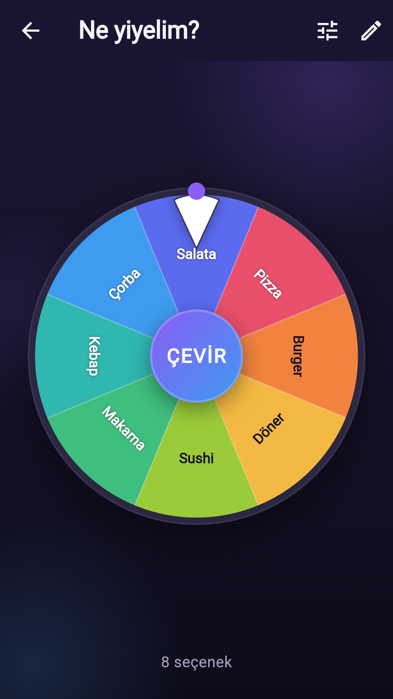
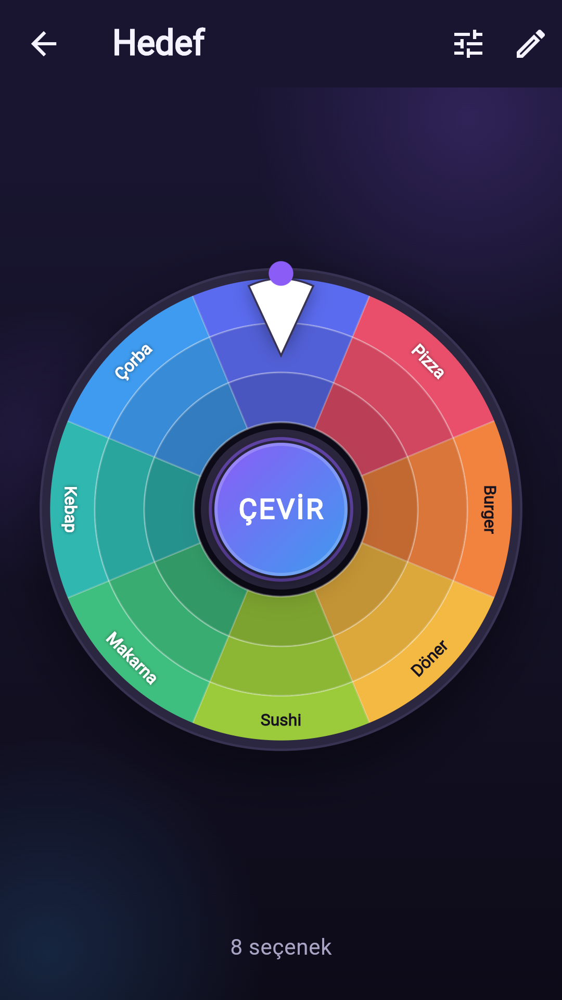
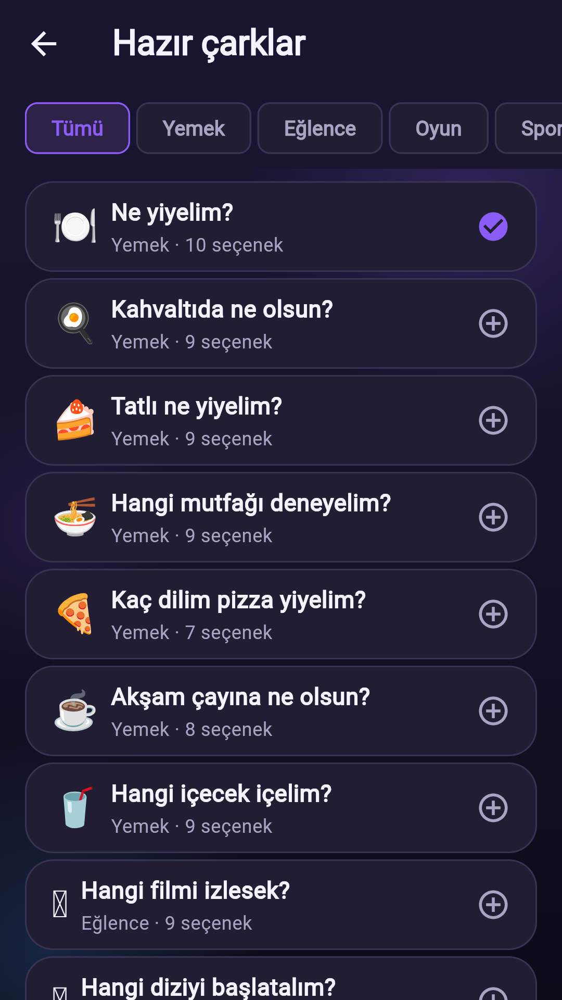
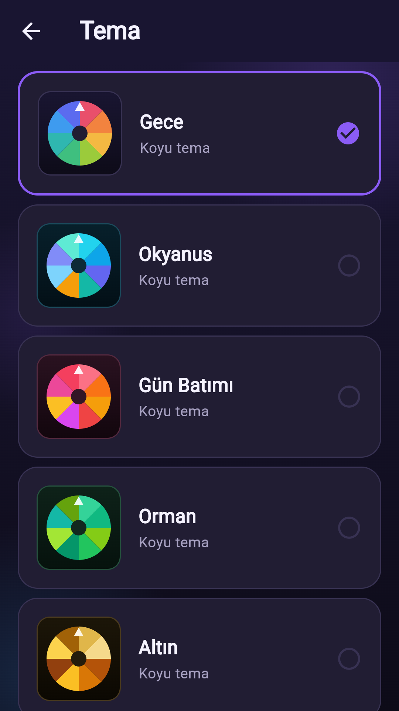

# Çarkıfelek 🎡

Kararsız kaldığın her an yanında: çarkı çevir, kararı şansa bırak.

Türkçe, **tamamen çevrimdışı** çalışan bir karar çarkı uygulaması. Flutter ile yazıldı,
Android'de yayınlanıyor. Reklamsız, hesapsız, veri toplamaz — uygulama **ağ izni bile istemez**.

| Çark | Hedef görünümü | Kütüphane | Temalar |
|---|---|---|---|
|  |  |  |  |

## Özellikler

- **66 hazır çark**, 12 kategori (yemek, eğlence, oyun, spor, günlük, karar, ekip, yaratıcı,
  çocuk, öğrenme, ev, sosyal)
- **4 çark görünümü** — klasik dilim, halka, hedef tahtası, ibreli kadran
- **6 tema** — Gece, Okyanus, Gün Batımı, Orman, Altın, Kâğıt. Tema değişince yalnızca çark
  değil tüm arayüz (arka plan, yüzey, yazı, buton, kaydırıcı) birlikte değişir.
- **Gerçekçi dönüş** — kısa hızlanma, sürtünmeli yavaşlama, hedefin az ötesine geçip yerine
  oturma; dilim sınırında tik sesi + titreşim
- **Kendi çarkını yap** — sınırsız seçenek, sürükle-sırala, toplu yapıştırma
- **Eleme modu** — kazanan listeden çıkar, son kişi kalana kadar
- **Teq Studio açılış ekranı**, ekran okuyucu etiketleri, "hareketi azalt" desteği

## Teknik

| | |
|---|---|
| Dil / çatı | Flutter 3.47 · Dart 3.13 |
| Durum | Riverpod |
| Yönlendirme | go_router |
| Kalıcılık | `shared_preferences` (şema `wheels_v1`, bozuk veriye dayanıklı) |
| Android | paket `com.teqstudio.carkifelek` · minSdk 24 · targetSdk 36 |
| İzinler | yok (INTERNET dahil) |
| Test | 103 test, `flutter analyze` temiz |

### Mimari

```
lib/
├── main.dart                  # SharedPreferences'ı yükleyip provider'a enjekte eder
├── app.dart                   # MaterialApp.router, tema, açılış ekranı katmanı
├── router.dart                # rotalar: /, /library, /themes, /wheel/:id
├── models/wheel.dart          # çark veri modeli (saf Dart, WheelStyle dahil)
├── core/wheel_library.dart    # 66 hazır çark, 12 kategori
├── data/                      # key-value store + JSON deposu
├── state/                     # provider'lar, çark listesi mantığı
├── screens/                   # liste, çark, editör, kütüphane, temalar
├── widgets/                   # çark painter, sheet, splash (TeqSplash), marka
└── theme/                     # 6 palet, getter tabanlı renkler, ızgara
```

Renkler `const` değil **getter**'dır (`lib/theme/palette.dart`): tema değişince arayüzün
tamamı aynı karede güncellenir. Çark çizimi tek bir dönen disk geometrisi kullanır; görünüm
farkı yalnızca `WheelPainter`'ın çizim yolundadır — kazanan hesabı, sürtünme ve ses değişmez.

## Geliştirme

```bash
flutter pub get
flutter analyze
flutter test
flutter run -d chrome          # hızlı önizleme
```

Web'de `?splash=hold` parametresi açılış ekranını ekranda tutar (tasarım incelemesi);
ekrana dokunmak açılış ekranını her durumda atlar.

## Yayın paketi

```bash
flutter build appbundle --release                              # Play (AAB)
flutter build apk --release --target-platform android-arm64    # telefona kurmak için (~18 MB)
```

İmzalama `android/key.properties` + upload keystore ile yapılır; **bu dosyalar repoda yoktur**
(`.gitignore`). Kendi anahtarını üretmek için:

```bash
python tool/gen_upload_keystore.py     # keystore + key.properties (git dışında)
```

Yayın adımlarının tamamı: [`store/YAYIN-ADIMLARI.md`](store/YAYIN-ADIMLARI.md)

## Gizlilik

Uygulama hiçbir kişisel veri toplamaz, sunucuya veri göndermez, reklam göstermez.
Ayrıntılar: [Gizlilik Politikası](https://alhndgn.github.io/carkifelek/)

## Lisans

© 2026 Teq Studio. Tüm hakları saklıdır.
